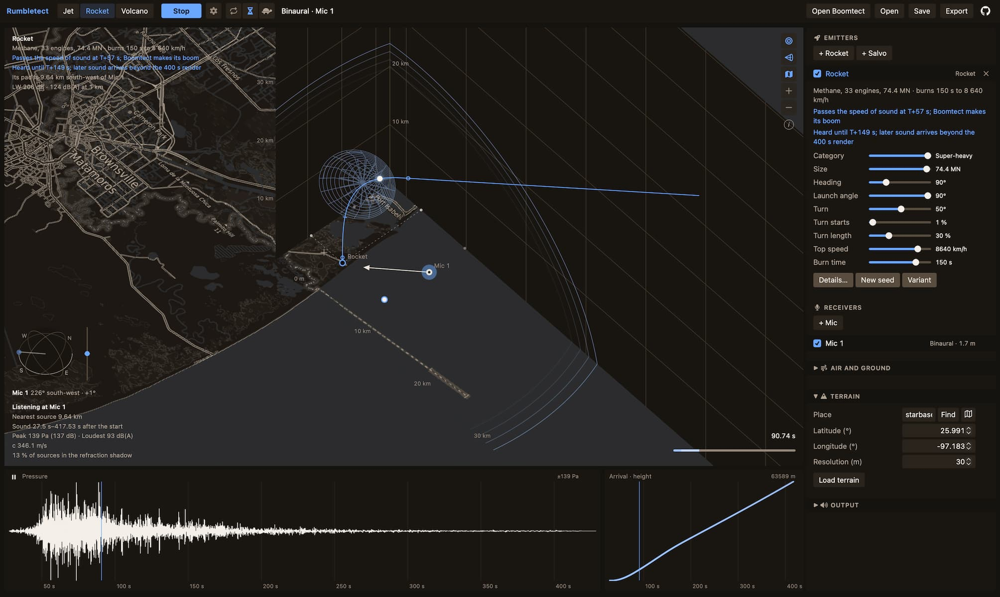

# Rumbletect: Design the rumble

Rumbletect designs the continuous sound of jets, airliners, rockets, and
volcanic eruptions from their physics. Plan a flight or an ascent in 3D over
real terrain, set the engine's power, place microphones, and hear the roar
trailing the aircraft, the ground's comb, and the air's swirl. Listen in mono, as
a spaced stereo pair, or binaurally on headphones, and export WAV or
Ambisonics. Made for sound design, built on physics.

See it live: [**https://janne-s.github.io/Rumbletect/**](https://janne-s.github.io/Rumbletect/)



## How it works

A source is a stream of short grains of noise along its path. Each grain has a
position, an emission time, and a spectrum toward every direction. A jet's
mixing noise has two parts: the large structures that roar aft and the
fine-scale turbulence heard to the side and ahead. Each grain travels to each
microphone with its own delay, Doppler shift, and loss, and the microphone
hears their sum. Long grains carry what lies below 20 Hz, down to about
1.5 Hz.

Jet, Rocket, and Volcano keep their own emitters and acoustic settings. The
active place and terrain travel with you when switching modes.

## Scene

- **Box** — The floor is the ground and the two far walls show the scene from
  the side. The cross on the floor is the origin. The box measures the scene;
  loaded terrain goes on beyond it and fades toward its own edge.
- **Points and shadows** — Drag a point to move it horizontally, or its shadow
  on the floor or a wall to move it in that plane. A flight's second point sets
  its heading.
- **View** — Drag empty space to turn, pinch or wheel to zoom, two fingers,
  Shift-drag, or the right button to pan, double-click to reset.
- **Selection** — Dashed lines lead from a selected microphone or emitter to its
  shadows on the floor and walls. A click on empty space clears it.
- **Shadow boundary** — The line on the ground beyond which refraction lifts the
  selected emitter's sound off the ground, for the microphone's height.
- **Levels** — A microphone shows its peak in pascals and decibels and its
  loudest A-weighted Fast level (LAFmax, IEC 61672-1). An emitter shows its
  sound power level LW and its A-weighted level 1 km away in its loudest
  direction, at its loudest moment.

## Jet

- **Category** — Hobby turbine, jet drone, cruise missile, fighter, or heavy
  bomber. Changes the engine and the engine count; the flight stays as set.
- **Power** — Idle to full power; for a fighter, through military power to
  full afterburner.
- **Height, climb, heading, Mach, acceleration** — Where it flies and how
  fast, speeding up or slowing down along the flight.
- **Turn, turn starts, turn radius** — Flies straight, then turns by the set
  angle on the set radius from the set second, up to five full circles; a
  long turn circles until the flight ends. Rings on the path mark the turn.
- **Flight time** — How long it flies. Setting it ends an automatic flight
  time.
- **Formation** — Its own kind: aircraft in a V behind the leader, each with
  its own seed. Spacing sets how far apart they fly, and the trail is in
  Details.
- **Turbomachinery** — A small turbine's blade-passing whine, rising with
  power, and a turbofan's fan hump.
- **Details** — Start point, onset, seed, engine count, the nozzle pressure
  ratio, jet temperature and nozzle diameter, and a formation's lateral and
  trail spacing.

## Airliner

- **Category** — Business jet, regional jet, narrowbody, widebody, or
  four-engine airliner. Changes the engines; the flight stays as set.
- **Power, height, climb, heading, Mach, acceleration, turn, turn starts,
  turn radius, flight time** — As for a jet.
- **Source** — A turbofan as two jets, a fast core and a slower fan stream,
  with the fan's blade-passing tones and broadband noise. At take-off power
  the buzz-saw adds a tone at every order of the shaft as the fan tips pass
  the speed of sound. The wing and tail trailing edges add airframe noise.
- **Gear & flaps** — In Details: landing gear, flaps, and slats out, as on
  approach. Their noise grows with the sixth power of speed.

## Rocket

- **Category** — Hobby, 122 mm artillery, heavy artillery, sounding rocket,
  small, medium, and heavy launcher, and super-heavy. Changes the engine, its
  propellant, and nozzle; the flight stays as set.
- **Size** — Total thrust from a 10 N hobby motor to a 100 MN super-heavy
  launcher. The nozzle and the water on the pad follow.
- **Heading, launch angle, turn, turn starts, turn length** — Straight along
  the launch angle, or turning by the set angle from a point along the path:
  down toward level flight, or with a negative angle lofting up, as ATACMS
  does after leaving its rail. Marks on the path show the turn and where the
  rocket passes the speed of sound of the air at its height.
- **Top speed** — The speed at burnout. The flight ends at burnout or where
  it comes down to the ground; sound already sent travels on. How late the
  speed builds is in Details.
- **Burn time** — How long the engine burns.
- **Salvo** — Its own kind, by default a 122 mm launcher's 40 rounds in 20 s.
  Each round is the same rocket with its own seed, launch time, launcher,
  heading, angle, and thrust. Rounds per salvo, spread, launcher radius, and
  the spreads are in Details.
- **Details** — The flight, and what the category sets: propellant (a faster
  exhaust sounds higher; liquid engines are held on the pad for three
  seconds), engine count, thrust, exhaust velocity, nozzle diameter, acoustic
  efficiency, and water on the pad.
- **Source** — Sound power from thrust and exhaust velocity, with the
  spectrum and directivity of BYU's SATURN model. A single nozzle peaks about
  an octave higher than a cluster. Low frequencies radiate toward the plume
  and start once the plume has left the pad. The plume crackles.

## Volcano

- **Category** — Strombolian, lava fountain, sub-Plinian, or Plinian
  eruption. Sets the jet's width, exit velocity, gas temperature, and pulsing.
- **Crater height** — The crater above the ground around it, or above the
  terrain when a map is on.
- **Jet width** — The width of the gas jet at the crater, which may be only
  part of the crater. The roar rises five jet widths above the crater, where
  the scene shows it.
- **Intensity, duration, pulsing, pulse period, rise, fade** — The
  eruption's strength and its course in time.
- **Bursts** — From a steady swell to Strombolian bursts: a background roar
  broken every pulse period or so by a burst that rises in tenths of a
  second, as at Mount Yasur.
- **Source** — The roar of a hot jet rising from the crater, and the smaller
  jets around it, which carry the audible roar.
- **Linked volcano** — A Boomtect volcano and a Rumbletect volcano follow
  each other's crater and onset when the tects are linked; everything else
  is set in each tect.

## Listening

- **Space** — Runs the main Render / Play / Stop action outside controls and
  dialogs.
- **Render** and **Play** — The button renders the scene when it has changed,
  then plays what the listening microphones hear. While a render runs, it
  stops it (the square beside the spinner).
- **Pause** — The button on the pressure plot holds playback where it is; Play
  goes on from there, Stop starts over.
- **Scrubbing** — Press either plot or the small scene timeline to move playback
  to that moment, and drag to move it further; on release it plays on from
  there, including from pause. The scene timeline also takes arrow keys (one
  second), Page Up / Down (one tenth of its duration), and Home / End. Sound
  fades in and out as it starts and stops.
- **Auto** (circling arrows, beside Play) — Renders again soon after every
  change. Off, changes wait for Render.
- **In progress** — Rendering and loading are listed in the corner of the
  scene while they run, each with how far it has come, how long it has run,
  and for requests over the network when it gives up. The last message stands
  above them: a note fades, an error stays.
- **Settings** (gear beside Play, also on mobile) — How much of the sound a
  render computes, kept with the scene: the cutoff level, the highest
  frequency, the echo detail (the echo cells' size), a scattered echo's
  arrivals, a coarse forest (on a coarse frequency grid), and shared scatter (a
  frame's scattered echoes spread in a few groups), the synthesis of grains
  (exact; fast, the same up to rounding; fastest, other noise of the same
  statistics), and coarse echoes (a grain's echoes leaving within 10° share
  one spectrum), with the cost against the
  full computation and an estimate of its time from the last render; the
  preview; and the threads this device renders on.
- **Preview** (turtle, beside Play or in the mobile view switches) — Renders a
  lighter version of the scene's settings: echo cells twice as large, and
  sound up to 2 kHz at most. An export is always rendered in full.
- **Real delay** (hourglass, beside Play) — On: the sound arrives as late as
  it would outdoors, and the clock in the corner counts from the start. Off:
  the silence before the first sound is skipped.
- **Length** — Up to 400 s from the first arrival. Later sound is left out,
  and the render says so.
- **View switches** — Down the scene's right edge, each icon lit while on,
  only those that apply.
- **Wavefront** — While the sound plays, shows the wavefronts where they cross
  the floor, the terrain, and the walls.
- **Cone** (cone icon) — While the sound plays, each supersonic jet's or
  rocket's Mach cone trails behind it through the fronts it has left.
- **Names** — Optional place names, peaks, and lakes from OpenFreeMap. Off
  initially; switch on to fetch names over loaded terrain. Labels vary with
  map scale. Switching off cancels a pending request.
- **Map** — A topographic map flat on the floor in place of the terrain's
  relief, in the scene's colours. It reaches as far as the view shows,
  coarser the farther out, and **+** and **−** zoom the view to look over a
  wider area. Works at the selected place with or without loaded terrain.
- **i** — The sources of the terrain and map data.
- **Phone** — The scene fills the screen. The parameters open one group at a
  time from the icons along the bottom, the plots fold into a strip that opens
  over the scene, and the selection's and the listening microphone's facts
  open from the name at the top.
- **Listen** — The checkbox on a microphone adds it to what plays. During
  playback, the sound continues from the same moment with the new
  combination. Microphones that do not listen still show their level, muted.
- **Type** — Omni hears the pressure. Binaural hears the sound field, turned
  to its orientation and decoded for headphones; it switches Spatial on. A new
  scene starts with a binaural microphone facing its emitter; microphones
  added later are omni, facing the first emitter that sounds.
- **Orientation** — Facing and elevation of a binaural microphone. On the
  sphere beside the scene, drag the handle on the horizon to face and the one
  on the scale beside it to tilt, or drag the arrowhead in the scene.
- **Combinations** — One omni microphone is mono, two are a stereo pair, more
  are one channel each. One binaural microphone is binaural; binaural and omni
  together are a stereo mix with the omni microphones in the centre. Surround
  plays one channel per speaker when the output has them, and otherwise as a
  stereo preview.
- **Spatial** — The Ambisonic order of the render, or Off.
- **Ear reflex** — The middle-ear reflex: after a loud onset, the low
  frequencies are turned down with a short delay, and the effect fades while
  the sound continues.
- **Loudness** — Compresses level differences the way perceived loudness
  grows with pressure (Stevens' power law, the same at every frequency).
- **Cap onsets** — Keeps Loudness from making a sharp onset after quiet louder
  than it was. On at first.
- **Level** — Normalizes to the peak, or uses a fixed full scale in pascals.
  A fixed scale keeps sounds as loud as each other as they are outdoors.
- **Distance loss** — 100 % is physical; less eases how fast a source fades
  with distance beyond the microphone's nearest path, keeping air absorption,
  directivity, Doppler shift, and ground.
- **Plots** — Pressure, and arrival time by source height, for every
  microphone on one time axis and one pressure scale, each in its own color
  and the muted ones dimmer. A microphone's tab, or selecting the microphone,
  brings it forward.

## Air

- **Lapse rate** — How fast the temperature falls with height; 6.5 K/km is the
  standard atmosphere, a negative value an inversion.
- **Refraction** — Sound bends toward slower air. Falling temperature bends it
  up and leaves a shadow on the ground; an inversion bends it down and carries
  it far. Off: homogeneous air.
- **Shadow floor** — How far below the unbent level the shadow can go, set by
  turbulent scattering.
- **Ground** — What the ground is made of: snow, forest floor, grass, soil,
  stony ground, water, or rigid ground. Water reflects like rigid ground.
- **Forest**, **Tree height**, and **Forest density** — Trees around the scene:
  sound under their canopy is muffled, and the forest answers every sound with
  a reverberant tail; a sparser forest does both less.
- **Surroundings** — Over level ground, the long rumble the land around returns
  of a loud sound. Over terrain with echoes, the echoes take its place.
- **Wind**, **Wind from**, and **Wind shear** — The wind at the ground, the
  compass direction it comes from, and how much it strengthens with height.
  Downwind, sound bends down and carries; upwind, the shadow comes closer.
- **Vapour height** — How quickly the water vapour thins out with height,
  which changes how much the upper air absorbs.
- **Tropopause** — Where the temperature stops falling; above it the air keeps
  one temperature.
- **Ground layer** and **Layer lapse** — A layer of air next to the ground with
  its own lapse rate, such as a low inversion on a calm night.
- **Scintillation** — The slow swirl of level that turbulence brings to a long
  sound.

Use **Reset app** in Settings to return to the initial workspace. After
confirmation it removes Rumbletect's saved scenes and preferences from this
browser and reloads. Other tects' data and downloaded files are kept.

## Terrain

- **Place** — Where the scene's origin lies, saved with the scene with or
  without terrain. The map button opens a map to move under the centre mark,
  with the area the scene needs around it. **Load** in this map dialog fetches
  terrain immediately. Loaded terrain follows the place.
- **Resolution** — The spacing of the heights. A scene too large for the
  terrain's budget takes a spacing two or more times as coarse.
- **Find** — Finds a place by name, or takes "latitude, longitude".
- **Load terrain** — Fetches the elevation the scene needs and saves it in the
  scene, so the scene opens the same way later without a connection. Place
  names load only while **Names** is on. Move or add something past the edge
  and the terrain it now needs loads a moment later.
- **Terrain** — Microphones stand on the ground. The panel shows heights both
  above the ground and above sea level, and the box's height lines are above
  sea level.
- **Shielding** — Hills between a source and a microphone block the direct and
  the reflected sound, and sound bends over their crests, more at low
  frequencies.
- **Echoes** — Slopes the source and the microphone both see send the sound
  back: sharply from where they mirror it, and scattered from everywhere else.
- **Scattering** — The share of the echo that scatters; the rest mirrors.
- **Echo cells** — Sources this close together share their echoes.
- **Echoes per cell** — The strongest echoes kept for each cell.
- **Contours** — Stripes the terrain by height.

## Export

**Export** packs the chosen files, several of them in a ZIP:

- **Scene (JSON)** — The full scene as JSON, with the files, the time of their
  first sample after the start, and the pascals at full scale. It opens as a
  scene.
- **Stereo** — What plays, in two channels: mono on both, a pair left and
  right, more microphones panned, binaural as heard on headphones.
- **Microphones** — One file per microphone: an omni's pressure in mono, a
  binaural microphone in stereo.
- **Ambisonics** — One AmbiX file per microphone (ACN, SN3D; front is north,
  left is west), when the render is spatial.
- **Terrain echoes** — With, without, or only the terrain's echoes.

All files are 32-bit float at one full scale. Files of more than two channels
are WAVE_FORMAT_EXTENSIBLE with no speaker positions. With per-microphone
files, every file starts at the same moment.

## Calibration

Rumbletect plays through the browser at the computer's volume, like any other
sound. Its levels are model values; with a fixed full scale they keep their
real relation, so a sound system can be set to play them at that level.

- **Peak** — The loudest moment plays at −3 dBFS whatever its pressure, so a
  quiet scene plays as loud as a loud one.
- **Fixed** — Full scale is a pressure: at 20 Pa a sample of 1.0 is 20 Pa, and
  0 dBFS is 120 dB SPL peak. Exported files keep the same scale.
- **To calibrate** — Choose Fixed, one omni microphone, and Ear reflex and
  Loudness off. Play a 1 kHz sine at −20 dBFS from any tone generator and set
  the speakers or headphones with a sound level meter to read the full scale's
  level less 23 dB: 97 dB SPL at 20 Pa. Leave the volume there. Binaural
  playback and mixes of several microphones are scaled down for headroom.

## Echotect

For echoes from buildings and streets, place a Rumbletect sound in an
[Echotect](https://github.com/janne-s/Echotect) echo field. In the export's
Echotect section, **Send to Echotect** opens Echotect with the chosen
microphone's sound in mono without terrain echoes, or **Save file** saves it
as a package (WAV and JSON) to choose in Echotect. **With** decides where it
lands: with Place, Echotect puts its Listener where the microphone was and its
Source the way the sound came from; with Direction, only its Source moves;
with Sound only, its scene stays as it is. One direction stands for a sound
that moves.

## Boomtect

**Open Boomtect** opens [Boomtect](https://github.com/janne-s/Boomtect) in its own
window and links the two windows. When Boomtect is already open, the button
reads **Link Boomtect**. Boomtect makes sonic booms, blasts, thunder, and
volcanic explosions.

- **One scene** — The place, terrain, air, ground, microphones, and render
  settings are the same in both windows, and a change in either reaches the
  other. A window the link opens starts with no emitters of its own, and its
  saved scenes stay as they were; after **Unlink** the scene on screen stays.
- **Heard together** — Each window renders its own emitters, and the
  microphones hear both: plots, levels, playback, the export, and Echotect get
  the sum. With **Auto** render on, Boomtect's new sound comes in at once;
  with it off, the arrows beside Boomtect's name take it in.
- **Followers** — Each Boomtect flight gets a jet here on its path, named after
  it, for its engines; each supersonic jet or rocket here gets a flight in
  Boomtect for its booms and Mach cone. A follower moves with what it follows
  and keeps a copy of the path, so it still sounds without the link. Its
  category and power are set here. Removed, it stays away while both windows are
  open.
- **Real and Balanced** — Above the pressure plot while linked: Real plays
  both tects at their real pressures; Balanced lifts the quieter one to the
  louder one's loudest A-weighted level, turning nothing down. The plot shows
  each tect in its own half, scaled to its own peak, with the lift beside its
  name. The microphone's levels are always the real sum. The cross at the
  right of the linked tect's half unlinks it.
- **Tects** — In the export while linked: Together exports the sum as heard;
  Separately exports each tect's sound in its own files at its real level, on
  one full scale and one time axis per microphone, with one scene file.
- **Boomtect's emitters** — Dimmed in the scene; a click on one shows it in
  Boomtect. Boomtect's name opens a button to bring its window forward and
  **Unlink**.

## Model

Every part of the model is marked with a class that says how far it can be
trusted, here and in the details of each parameter:

- **A** — Derived from first principles, such as travel time in uniform air.
- **B** — An approximation from the literature, valid in the range its source
  gives.
- **C** — A heuristic or synthetic assumption, chosen to behave plausibly
  rather than derived or measured.

B/C marks a part that combines the two.

| Part | Model | Class |
|---|---|---|
| Jet velocity | ideal nozzle | A |
| Mixing noise spectra | Tam, Golebiowski & Seiner 1996 | B |
| Mixing noise level with size | Khavaran & Bridges 2009, fitted | B/C |
| Peak frequencies | full-scale F-35AA and F-22A, Gee, Neilsen & Wall 2013, fitted | B/C |
| Directivity | Tam 1996 figs. 6–7 | B |
| Flight effects | Stone, Krejsa & Clark 2003, combined | B/C |
| Skewness, intermittency | Gee et al. 2013, fitted to recordings | B/C |
| Engine settings | from published thrust and mass flow; a turbofan as a core and a fan stream | C |
| Turbomachinery tones and fan hump | fitted to model-turbine and B-52 recordings | C |
| Airliner fan broadband shape | Heidmann 1975 | B |
| Airliner fan levels | fitted to the EASA ANP 2.3 noise-power-distance data | C |
| Airframe noise | Fink 1977 as in ANOPP (Zorumski 1982) | B |
| Shock-cell noise | Stone, Krejsa & Clark 2003, from the fully expanded Mach number; flight term limited to Mach 0.8 | B |
| Crackle | simple-wave steepening of each grain, set by the jet's convection Mach number | C |
| Rocket source | sound power from thrust (Mathews & Gee 2025), SATURN spectrum and directivity (Mathews 2025) | B |
| Ascent, sizing, salvo | authored, not simulated | C |
| Eruption jet | Tam's spectra as fitted to volcano infrasound (Matoza et al., Gestrich et al. 2021); vents and velocities assumed | B/C |
| Doppler shift | each grain's time compressed by `1 − M cos ψ` | A |
| Speed of sound | `c = sqrt(γRT)` | A |
| Temperature profile | layers: a ground layer, the troposphere, constant above the tropopause (ISO 2533) | B/C |
| Travel time, rays, and spreading | circular rays in a linear `c(z)`, ray tubes; `1/R` without refraction | A |
| Wind | effective sound speed along each path, linear in height | B/C |
| Refraction shadow | grazing ray, creeping wave along the ground (Fock), softer over porous ground at high frequencies, floor | B/C |
| Terrain shielding | thin-edge Fresnel–Kirchhoff diffraction, Deygout's edges | B |
| Rounded ridges | each edge adds a cylinder's loss for its crest's radius (ITU-R P.526) | B/C |
| Terrain echoes, mirrored | stationary path on the surface, focusing by its curvature | A |
| Terrain echoes, scattered | Lambert's law per patch of ground | B |
| Echo cells and merging | sources pooled in cells; scattered echoes merged by arrival and direction | C |
| Air absorption | ISO 9613-1 at the frequency that arrives; with refraction, the mean over the heights a path spans | B |
| Ground reflection | Delany–Bazley impedance, spherical-wave coefficient | B |
| Ground reflection, partly coherent | ground roughness of 5 cm (Rayleigh) and turbulence (Clifford & Lataitis) | B/C |
| Scintillation | fitted to recordings | C |
| Forest, under the canopy | ISO 9613-2 foliage attenuation, up to 200 m | B |
| Forest reverberation | seeded diffuse tail at the microphone with an early and a late slope per octave, fitted to eight measured forest responses (Koli, Finland), driven by each path's way under the canopy | B/C |
| Surroundings | seeded diffuse tail at the microphone over level ground, fitted to recorded booms | C |
| Distance loss below 100 % | creative easing of spreading | C |
| Ambisonics | spherical harmonics, AmbiX | A |
| Ear reflex | threshold, latency, low-frequency attenuation, adaptation | B/C |
| Loudness | Stevens' power law on the level envelope | B/C |

Not modelled: screech, afterburner combustion noise, and sonic booms, which Boomtect makes.

Rumbletect is a creative tool. Where published models exist it follows them,
but a result is a plausible sound, not a reconstruction or a measurement.
Levels are model values in pascals and are not calibrated.

## Running locally

```sh
npm start
```

Open http://localhost:8002/. Run the tests with `npm test`.

The model's tuning values and limits are in `src/domain/constants.js`; the
parameters a scene sets, with their defaults and ranges, in
`src/domain/scene.js`.

## Data

Terrain heights: [Terrain Tiles](https://github.com/tilezen/joerd/blob/master/docs/attribution.md)
by Mapzen on AWS Open Data (SRTM, GMTED2010, NED, ETOPO1, EU-DEM, and national
datasets). Place search: [OpenStreetMap Nominatim](https://nominatim.openstreetmap.org/).
Map and place names: © [OpenStreetMap](https://www.openstreetmap.org/copyright)
contributors. Optional place labels use [OpenFreeMap](https://openfreemap.org/)
vector tiles with the © [OpenMapTiles](https://openmaptiles.org/) schema
(CC BY 4.0); no API key is required. All are fetched only when asked for.

## Third-party code

Binaural decoding uses [Omnitone](https://github.com/GoogleChrome/omnitone)
1.3.0 with its SADIE HRIRs, under the Apache License 2.0
([notice](src/shared/vendor/omnitone/NOTICE)).

Icons are [Font Awesome Free](https://fontawesome.com) 7.3.1, solid style:
font under the SIL OFL 1.1, CSS under the MIT License, icons under CC BY 4.0
([license](assets/vendor/fontawesome/LICENSE.txt)).

## License

MIT

## Support Rumbletect

Support development through [GitHub Sponsors](https://github.com/sponsors/janne-s)
or [Ko-fi](https://ko-fi.com/jannesarkela). See
[Sanara Creations](https://www.sanaracreations.fi/) for related work.
